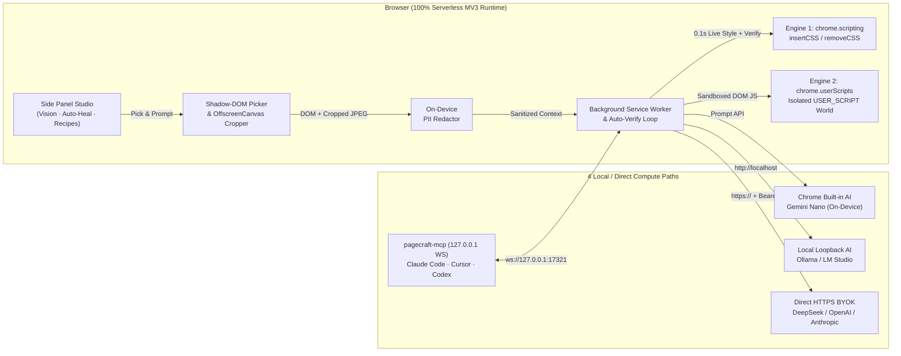

<div align="center">

# PageCraft

**PageCraft — The Open-Source Live Webpage Customizer & Browser Micro-Agent Runtime (100% Serverless, Zero-Telemetry)**

Point at any webpage element and reshape the web in plain words — remove clutter, restyle layouts with live CSS, export tables to Excel/CSV, generate standard Tampermonkey `.user.js` scripts, or let **Claude Code / Cursor / Codex** customize live tabs over MCP.

[](./LICENSE)
[](https://github.com/botshen/pagecraft/actions/workflows/ci.yml)
[](https://developer.chrome.com/docs/extensions/develop/migrate/what-is-mv3)
[](./PRIVACY.md)
[](#pagecraft-mcp-bridge-claude-code--cursor--codex)
[](./CONTRIBUTING.md)

**English** · [简体中文](./README.zh-CN.md) · [Official Website](https://pagecraft.shenxin.space) · [Interactive Sandbox](https://pagecraft.shenxin.space/playground?lang=en) · [Issues](https://github.com/botshen/pagecraft/issues) · [Discussions](https://github.com/botshen/pagecraft/discussions)

</div>

---

**PageCraft** is a 100% serverless, local-first Chrome & Edge Manifest V3 Side Panel extension and browser micro-agent runtime. It pairs a **Shadow-DOM visual element picker**, **multimodal cropped screenshot context**, and a **closed-loop auto-verification & self-healing runtime** with **4 local/direct compute paths** — with **zero proprietary backend servers**, **zero install IDs**, and **zero telemetry**.

## Highlights

| Pillar | What Makes PageCraft Different |
| :--- | :--- |
| **Zero-Backend & 100% Local-First** | Pure client-side MV3 architecture. Zero cloud middleman proxies, zero account walls, and zero background telemetry. Before any user-initiated prompt leaves the browser, on-device PII redaction scrubs emails, `sk-...` / `Bearer` tokens, JWTs, numeric IDs, URL query secrets, and password fields. |
| **Multimodal Vision + Closed-Loop Auto-Healing** | When you click an element, PageCraft crops a compact region screenshot (`max 640px` via `OffscreenCanvas`) for vision-capable models — and automatically falls back to text-only if an endpoint returns HTTP `400`/`415`/`422`. Every generated mod is live-verified on the DOM; if `0` elements match, PageCraft extracts fresh DOM landmarks and runs a **1-pass self-healing refinement** automatically. |
| **Dual-Engine Runtime (`CSS` + `JS`)** | **Engine 1 (`CSS`)** injects clean styles in `0.1s` via `chrome.scripting.insertCSS` / `removeCSS` with zero extra browser toggles, live sliders (font size, width, paper warmth), and SPA `pushState` sync. **Engine 2 (`JS`)** runs interactive DOM tools (CSV/Excel export, copy unlockers, custom buttons) inside Chrome MV3's isolated `chrome.userScripts` world (`csp: "script-src 'self'"`, `messaging: false`). |
| **PageCraft MCP Bridge (`pagecraft-mcp`)** | Connect **Claude Code**, **Cursor**, or **Codex** over a strict `127.0.0.1` loopback WebSocket so your terminal/IDE coding agent can inspect picked elements, test live CSS selectors, and hot-apply persistent mods on real authenticated tabs. |
| **`#PC1:...#` Recipes & Tampermonkey Interop** | Share any mod as a self-contained `#PC1:...#` shortcode or deep link, or export/import standard `==UserScript==` `.user.js` files compatible with **Tampermonkey** and **ScriptCat**. |

## 4 Compute Options (Switch Anytime in Settings)

All mods, recipes, and settings stay strictly in `chrome.storage.local` (guarded by Web Locks atomic transactions):

1. **Chrome Built-in Gemini Nano (`LanguageModel` API — 0-Config Offline)**
   Run on-device inference directly inside Chrome with zero API keys, zero network calls, and zero local server setup (`chrome://flags/#prompt-api-for-gemini-nano`).
2. **Offline Local AI (`Ollama` / `LM Studio` — Keyless Loopback)**
   Run completely air-gapped against **Ollama** (`http://localhost:11434/v1`, default `qwen2.5-coder:7b` or vision `qwen2.5vl`) or **LM Studio** (`http://localhost:1234/v1`) — **no API key required**.

   > **Tip — Running Ollama with Chrome Extensions:**
   > Launch Ollama with `chrome-extension://*` allowed in `OLLAMA_ORIGINS` so local extension requests are not blocked by CORS `403`:
   > ```bash
   > OLLAMA_ORIGINS="chrome-extension://*" ollama serve
   > ollama pull qwen2.5-coder:7b
   > ```
3. **Direct BYOK (`HTTPS` Browser-to-Provider)**
   Connect directly from your browser to **DeepSeek**, **OpenAI**, **Anthropic**, **OpenRouter**, **SiliconFlow**, or any custom `https://` OpenAI-compatible endpoint. Keys never leave local extension storage.
4. **Local Coding Agents via `pagecraft-mcp` (`Claude Code` · `Cursor` · `Codex`)**
   Let the coding agent you already use in your terminal or IDE drive PageCraft's DOM picker, live selector verifier, and dual-engine injector over `ws://127.0.0.1:17321`.

## PageCraft MCP Bridge (Claude Code / Cursor / Codex)

1. Open PageCraft **Settings → Local Coding Agent Bridge (`pagecraft-mcp`)** and toggle **Enable Local MCP Bridge** ON.
2. Add `pagecraft-mcp` to your coding agent (or click **Copy MCP Config JSON** right inside Settings, replacing `/path/to/pagecraft` with your local clone path):

```json
{
  "mcpServers": {
    "pagecraft": {
      "command": "node",
      "args": ["--experimental-strip-types", "/path/to/pagecraft/packages/mcp/src/cli.ts"]
    }
  }
}
```

Or register directly in **Claude Code**:

```bash
claude mcp add pagecraft -- node --experimental-strip-types /path/to/pagecraft/packages/mcp/src/cli.ts
# Or launch standalone from the repository root:
pnpm mcp
```

Exposed MCP tools: `pagecraft_get_active_page`, `pagecraft_trigger_picker`, `pagecraft_get_picked_element`, `pagecraft_verify_selectors`, `pagecraft_apply_mod`, `pagecraft_list_mods`, and `pagecraft_toggle_mod`.

## Architecture



## Quick Start (Build from Source)

**Prerequisites:** [Node.js](https://nodejs.org/) `>= 22.6.0` and [pnpm](https://pnpm.io/) `>= 9`.

```bash
# 1. Clone and install dependencies
git clone https://github.com/botshen/pagecraft.git
cd pagecraft
pnpm install

# 2. Build the production Manifest V3 extension
pnpm build
```

Load the unpacked extension in **Chrome** or **Edge**:
1. Open `chrome://extensions` (or `edge://extensions`) and enable **Developer mode**.
2. Click **Load unpacked** and select the generated `.output/chrome-mv3` directory.
3. Pin **PageCraft** to your toolbar and click its icon to open the Side Panel Studio!

### Developer Commands

```bash
pnpm dev          # Start WXT hot-reload dev build (.output/chrome-mv3-dev)
pnpm compile      # TypeScript strict type-check
pnpm test         # Run core unit, vision/auto-heal & security test suite
pnpm build        # Build production MV3 bundle (.output/chrome-mv3)
pnpm mcp          # Launch local pagecraft-mcp stdio/WebSocket bridge from source
pnpm zip          # Package store-ready ZIP archive
```

## Contributing & Community

Contributions, website recipe templates, bug reports, and feature ideas are warmly welcome!

- **Contribute Code or Built-in Website Recipes:** Read [**`./CONTRIBUTING.md`**](./CONTRIBUTING.md) for local setup and how to add a new 1-click recipe to `lib/userscripts/templates.ts`.
- **Bugs & Recipe Requests:** Open a ticket on [**GitHub Issues**](https://github.com/botshen/pagecraft/issues) or email [botzgbj@gmail.com](mailto:botzgbj@gmail.com).
- **Questions, Showcases & `#PC1:...#` Recipes:** Join [**GitHub Discussions**](https://github.com/botshen/pagecraft/discussions).
- **Security & Privacy:** See [**`./SECURITY.md`**](./SECURITY.md) and [**`./PRIVACY.md`**](./PRIVACY.md).

## License

Released under the [**MIT License**](./LICENSE).
