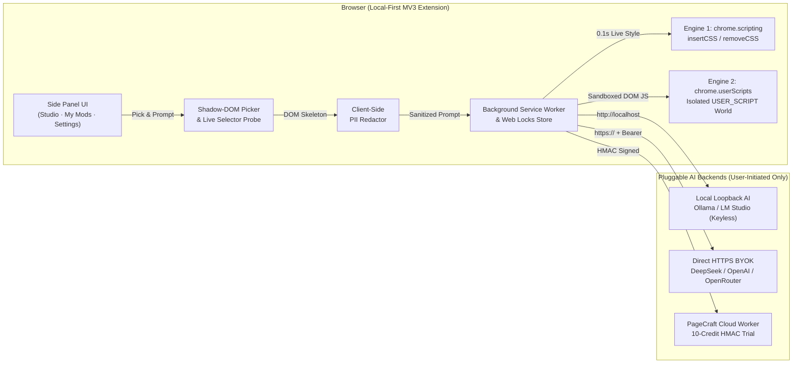

<div align="center">

# PageCraft

**Point at any webpage element and reshape the web in plain words — remove popups, customize CSS, export tables to Excel/CSV, or generate Tampermonkey userscripts.**

[](./LICENSE)
[](https://github.com/botshen/plugin-radar/actions/workflows/ci.yml)
[](https://developer.chrome.com/docs/extensions/develop/migrate/what-is-mv3)
[](./PRIVACY.md)
[](./CONTRIBUTING.md)

**English** · [简体中文](./README.zh-CN.md) · [Official Website](https://pagecraft.shenxin.space) · [Interactive Sandbox](https://pagecraft.shenxin.space/playground?lang=en) · [Issues](https://github.com/botshen/plugin-radar/issues) · [Discussions](https://github.com/botshen/plugin-radar/discussions)

</div>

---

**PageCraft** is an open-source, local-first Chrome & Edge Side Panel extension that turns natural-language prompts and visual element clicks into clean, persistent CSS tweaks and standard `.user.js` userscripts — with **zero DevTools (`F12`) hunting** and **zero background telemetry**.

## Why PageCraft?

| Capability | How PageCraft Works |
| :--- | :--- |
| **Dual-Engine Runtime (`CSS` + `JS`)** | **Level 1 (`CSS`)** applies layout cleanup, reading widths, and dark themes in `0.1s` via `chrome.scripting.insertCSS` / `removeCSS` — **zero extra browser developer toggles**, instant live ON/OFF, and SPA `pushState` route sync. **Level 2 (`JS`)** runs interactive DOM tools (CSV/Excel table export, copy unlockers, custom buttons) inside Chrome MV3's isolated `chrome.userScripts` world (`csp: "script-src 'self'"`, `messaging: false`, zero remote code). |
| **Shadow-DOM Element Picker** | Hover and click any popup, sidebar, repeating card list, or data table on a live SPA. PageCraft isolates its overlay in a closed Shadow root, filters noisy CSS Module / Tailwind hashes, detects sibling list selectors, and verifies live selector hits automatically. |
| **Zero-Credit CSS Quick Sliders** | Adjust **Font Size**, **Reading Width**, and **Paper Warmth** live on any site with instant sliders — consuming **0 AI credits**. |
| **`#PC1:...#` Shareable Recipe Shortcodes** | Package any mod into a compact, self-contained `#PC1:...#` shortcode or deep link (`https://pagecraft.shenxin.space/playground?recipe=...`) to share with teammates or the community in one paste, plus 1-click `.user.js` export/import for **Tampermonkey** and **ScriptCat**. |
| **Client-Side PII Redaction** | Before any user-initiated prompt leaves the browser, PageCraft scrubs emails, API keys (`sk-...`, `Bearer ...`), JWTs, long numeric IDs, URL query tokens, and password fields on-device. |

## 3 Flexible AI Backends

Switch engines anytime in **Settings** — your rules and recipes stay 100% local in `chrome.storage.local`:

1. **Free Cloud Trial (10 Credits, Zero Setup)**
   Start modifying pages immediately after install with 10 free cloud generations (plus an unlimited **0-credit Interactive Sandbox** at [`/playground`](https://pagecraft.shenxin.space/playground?lang=en)).
2. **Bring Your Own Key (`BYOK`)**
   Connect directly from your browser to **DeepSeek**, **OpenAI**, **OpenRouter**, **SiliconFlow**, or any custom `https://` OpenAI-compatible gateway. Keys are stored strictly in local extension storage and never transit PageCraft servers.
3. **100% Offline Local AI (`Ollama` / `LM Studio`)**
   Run completely air-gapped on `http://localhost:11434/v1` (built-in **Ollama** preset, default `qwen2.5-coder:7b`) or `http://127.0.0.1:1234/v1` (**LM Studio**) — **no API key required** and zero bytes leave your machine.

   > **Tip — Running Ollama with Chrome Extensions:**
   > Launch Ollama with `chrome-extension://*` allowed in `OLLAMA_ORIGINS` so local requests are not blocked by CORS `403`:
   > ```bash
   > OLLAMA_ORIGINS="chrome-extension://*" ollama serve
   > ollama pull qwen2.5-coder:7b
   > ```

## Architecture



## Quick Start (Build from Source)

**Prerequisites:** [Node.js](https://nodejs.org/) `>= 22.6.0` and [pnpm](https://pnpm.io/) `>= 9`.

```bash
# 1. Clone and install dependencies
git clone https://github.com/botshen/plugin-radar.git
cd plugin-radar
pnpm install

# 2. Build the production Manifest V3 extension
pnpm build
```

Load the unpacked extension in **Chrome** or **Edge**:
1. Open `chrome://extensions` (or `edge://extensions`) and enable **Developer mode**.
2. Click **Load unpacked** and select the generated `.output/chrome-mv3` directory.
3. Pin **PageCraft** to your toolbar and click its icon to open the Side Panel Studio!

### Developer Commands

```bash
pnpm dev          # Start WXT hot-reload dev build (.output/chrome-mv3-dev)
pnpm compile      # TypeScript strict type-check
pnpm test         # Run core unit & security test suite
pnpm build        # Build production MV3 bundle (.output/chrome-mv3)
pnpm zip          # Package store-ready ZIP archive
```

## Self-Hosting the Cloud Worker

PageCraft works standalone with **Local AI (Ollama / LM Studio)** or **BYOK**. If you want to host your own free-trial proxy, landing page, `/playground`, and `/admin` console on Cloudflare Workers + D1, follow the step-by-step guide in [**`./workers/cloud/README.md`**](./workers/cloud/README.md).

## Contributing & Community

Contributions, website recipe templates, bug reports, and feature ideas are warmly welcome!

- **Contribute Code or Built-in Website Recipes:** Read [**`./CONTRIBUTING.md`**](./CONTRIBUTING.md) for local setup and how to add a new 1-click recipe to `lib/userscripts/templates.ts`.
- **Bugs & Recipe Requests:** Open a ticket on [**GitHub Issues**](https://github.com/botshen/plugin-radar/issues) or email [botzgbj@gmail.com](mailto:botzgbj@gmail.com).
- **Questions, Showcases & `#PC1:...#` Recipes:** Join [**GitHub Discussions**](https://github.com/botshen/plugin-radar/discussions).
- **Security & Privacy:** See [**`./SECURITY.md`**](./SECURITY.md) and [**`./PRIVACY.md`**](./PRIVACY.md).

## License

Released under the [**MIT License**](./LICENSE).
