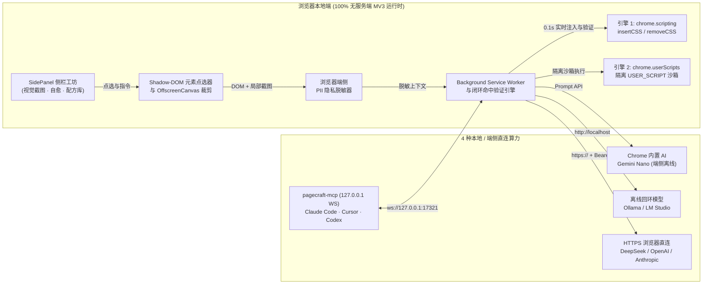

<div align="center">

# PageCraft 网页工坊

**PageCraft — 开源实时网页改造与浏览器微智能体运行时（100% 纯前端无服务端 · 零遥测）**

不用按 `F12` 翻代码：鼠标点选任意网页元素，用自然语言去弹窗干扰、调宽屏护眼排版、给表格加导出 Excel/CSV 按钮、生成标准油猴 `.user.js` 脚本，或通过 `pagecraft-mcp` 让本机 **Claude Code / Cursor / Codex** 直接改造你的真实登录页。

[](./LICENSE)
[](https://github.com/botshen/plugin-radar/actions/workflows/ci.yml)
[](https://developer.chrome.com/docs/extensions/develop/migrate/what-is-mv3)
[](./PRIVACY.md)
[](#pagecraft-mcp-本地编程智能体桥接claude-code--cursor--codex)
[](./CONTRIBUTING.md)

[English](./README.md) · **简体中文** · [官方网站](https://pagecraft.shenxin.space) · [交互练习靶场](https://pagecraft.shenxin.space/playground) · [问题反馈 Issues](https://github.com/botshen/plugin-radar/issues) · [社区讨论 Discussions](https://github.com/botshen/plugin-radar/discussions)

</div>

---

**PageCraft（网页工坊）** 是一款 100% 纯客户端、本地优先的 Chrome / Edge Manifest V3 侧边栏扩展与浏览器微智能体运行时。它将 **Shadow-DOM 可视化元素点选**、**多模态元素局部截图视觉上下文**、**实时选择器闭环验证与零命中自动修复（Auto-Heal）** 以及 **4 种本地/直连算力方式**融为一体——**零官方中转服务器、零设备安装 ID 追踪、零后台遥测**。

## 核心架构亮点

| 核心支柱 | 技术细节与体验优势 |
| :--- | :--- |
| **100% 零服务端与端侧隐私脱敏** | 纯客户端 MV3 架构，无任何专有云网关或账号墙。仅在你主动点击生成时读取当前目标 DOM 骨架，并在浏览器端侧自动抹除邮箱、`sk-...` / `Bearer` 密钥、JWT、长数字编号、URL 敏感查询参数与密码框内容。 |
| **多模态视觉截图 + 闭环自愈（Auto-Heal）** | 点选元素后自动通过 `OffscreenCanvas` 裁剪目标区域紧凑截图（最长边 `<= 640px`）供视觉模型理解真实排版；遇到纯文本模型返回 HTTP `400`/`415`/`422` 时**自动无感降级为纯文本重试**。每次生成后立即在真实 DOM 验证选择器命中数，若命中为 `0` 则自动拉取最新页面骨架完成 **1 轮闭环自愈修正**。 |
| **CSS + JS 双引擎分级执行** | **引擎 1（`CSS` 实时样式）** 基于 `chrome.scripting.insertCSS` / `removeCSS`，**免开任何开发者开关，0.1 秒生效**，内置字号/栏宽/暖度实时滑块与 SPA 单页路由同步。<br/>**引擎 2（`JS` 油猴沙箱）** 运行于官方 MV3 `chrome.userScripts` 隔离世界（`csp: "script-src 'self'"`、`messaging: false`），支持表格导出 Excel/CSV（内置 UTF-8 BOM 防中文乱码）、解除复制限制等交互增强。 |
| **`pagecraft-mcp` 本地智能体桥接** | 通过严格绑定 `127.0.0.1` 的本地 WebSocket 桥接，让终端或 IDE 中的 **Claude Code**、**Cursor**、**Codex** 直接读取已点选元素、验证真实页面选择器并热注入持久化改造规则。 |
| **`#PC1:...#` 配方口令与油猴互通** | 任意规则可一键编码为 `#PC1:...#` 自包含口令或分享链接，同时 100% 兼容导出/导入标准 `.user.js` 脚本至 **Tampermonkey（篡改猴）** 与 **ScriptCat（脚本猫）**。 |

## 四种算力接入方式（在「设置」中随时切换）

所有改造规则与配置均通过 Web Locks 原子锁保存在本机 `chrome.storage.local`：

1. **Chrome 内置端侧 AI（`Gemini Nano` / `LanguageModel` API — 零配置离线）**
   直接调用 Chrome 浏览器内置端侧大模型，免 API Key、免装额外软件、100% 本机离线推理（可通过 `chrome://flags/#prompt-api-for-gemini-nano` 开启）。
2. **100% 离线本地模型（`Ollama` / `LM Studio` — 免 Key 回环直连）**
   内置 **Ollama**（`http://localhost:11434/v1`，推荐 `qwen2.5-coder:7b` 或多模态 `qwen2.5vl`）与 **LM Studio**（`http://localhost:1234/v1`）预设——**无需填写 API Key**，数据 100% 不出本机。

   > **提示 — 启动 Ollama 避免 Chrome 扩展 403 CORS 拦截：**
   > 请在启动 Ollama 时放行 `chrome-extension://*` 跨域来源，以便浏览器扩展直接调用本机接口：
   > ```bash
   > OLLAMA_ORIGINS="chrome-extension://*" ollama serve
   > ollama pull qwen2.5-coder:7b
   > ```
3. **自带 API Key 浏览器直连（`BYOK`）**
   浏览器通过 HTTPS 直连 **DeepSeek**、**硅基流动（SiliconFlow）**、**OpenAI**、**Anthropic**、**OpenRouter** 或任意兼容接口，密钥仅存本机浏览器存储。
4. **本地编程智能体桥接（`pagecraft-mcp`：Claude Code · Cursor · Codex）**
   无需重复配置密钥，直接复用你终端/IDE 中已登录的编程智能体通过 `ws://127.0.0.1:17321` 操控浏览器 DOM 点选与实时改造。

## PageCraft MCP 本地编程智能体桥接（Claude Code / Cursor / Codex）

1. 打开 PageCraft 侧栏 **设置 → 本地编程智能体桥接（`pagecraft-mcp`）**，开启 **启用本地 MCP 桥接客户端**。
2. 在 Cursor / Claude Desktop 中添加以下配置（也可直接在设置页一键点击 **复制 MCP 配置 JSON**）：

```json
{
  "mcpServers": {
    "pagecraft": {
      "command": "npx",
      "args": ["-y", "pagecraft-mcp"]
    }
  }
}
```

或在 **Claude Code** 中一行命令注册：

```bash
claude mcp add pagecraft -- npx -y pagecraft-mcp
# 若从源码仓库直接启动桥接服务：
pnpm mcp
```

内置暴露的 7 个标准 MCP 工具：`get_active_page`、`trigger_element_picker`、`get_picked_element`、`verify_selectors`、`apply_page_mod`、`list_page_mods`、`toggle_page_mod`。

## 系统架构



## 从源码快速构建与安装

**环境要求：** [Node.js](https://nodejs.org/) `>= 22.6.0` 与 [pnpm](https://pnpm.io/) `>= 9`。

```bash
# 1. 克隆仓库并安装依赖
git clone https://github.com/botshen/plugin-radar.git
cd plugin-radar
pnpm install

# 2. 构建 Chrome / Edge MV3 生产扩展包
pnpm build
```

在 **Chrome** 或 **Edge** 中加载未打包扩展：
1. 打开 `chrome://extensions`（或 `edge://extensions`），开启右上角 **开发者模式（Developer mode）**。
2. 点击 **加载已解压的扩展程序（Load unpacked）**，选择构建生成的 `.output/chrome-mv3` 目录。
3. 将 **PageCraft** 固定到浏览器工具栏，点击图标即可呼出侧栏工坊！

### 常用开发命令

```bash
pnpm dev          # 启动 WXT 热更新开发模式 (.output/chrome-mv3-dev)
pnpm compile      # 运行 TypeScript 严格类型检查
pnpm test         # 运行核心单元、视觉自愈与安全测试套件
pnpm build        # 构建生产环境 MV3 扩展包 (.output/chrome-mv3)
pnpm mcp          # 从源码直接启动本地 pagecraft-mcp 桥接服务
pnpm zip          # 打包商店发布用 ZIP 包
```

## 参与贡献与社区反馈

欢迎提交 PR、分享好用的网站净化/效率配方，或反馈使用问题！

- **贡献代码与内置网站配方：** 请阅读 [**`./CONTRIBUTING.md`**](./CONTRIBUTING.md)，了解项目结构以及如何在 `lib/userscripts/templates.ts` 中新增一键同款配方。
- **Bug 反馈与新配方许愿：** 请前往 [**GitHub Issues**](https://github.com/botshen/plugin-radar/issues) 或发送邮件至 [botzgbj@gmail.com](mailto:botzgbj@gmail.com)。
- **使用交流与 `#PC1:...#` 配方分享：** 欢迎参与 [**GitHub Discussions**](https://github.com/botshen/plugin-radar/discussions)。
- **安全与隐私说明：** 详见 [**`./SECURITY.md`**](./SECURITY.md) 与 [**`./PRIVACY.md`**](./PRIVACY.md)。

## 开源协议

本项目基于 [**MIT License**](./LICENSE) 开源发布。
