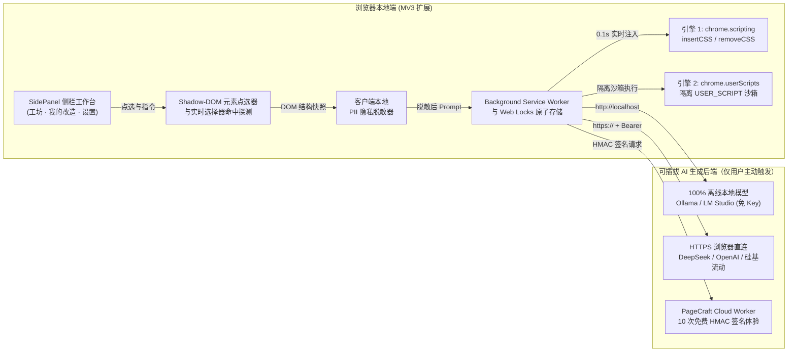

<div align="center">

# PageCraft 网页工坊

**不用按 F12 翻代码，鼠标点选任意网页元素，用大白话去弹窗干扰、调宽屏护眼排版、给表格加导出 Excel/CSV 按钮，或一键生成标准油猴脚本。**

[](./LICENSE)
[](https://github.com/botshen/plugin-radar/actions/workflows/ci.yml)
[](https://developer.chrome.com/docs/extensions/develop/migrate/what-is-mv3)
[](./PRIVACY.md)
[](./CONTRIBUTING.md)

[English](./README.md) · **简体中文** · [官方网站](https://pagecraft.shenxin.space) · [免额度交互靶场](https://pagecraft.shenxin.space/playground) · [问题反馈 Issues](https://github.com/botshen/plugin-radar/issues) · [社区讨论 Discussions](https://github.com/botshen/plugin-radar/discussions)

</div>

---

**PageCraft（网页工坊）** 是一款开源、本地优先的 Chrome / Edge Manifest V3 侧边栏扩展。它将**可视化网页元素点选**与 **CSS + JS 双引擎执行**结合在一起，让你用自然语言随手改造任何网页，同时坚持**零浏览记录追踪、零远程代码注入**。

## 为什么选择 PageCraft？

| 核心能力 | 技术亮点与体验优势 |
| :--- | :--- |
| **CSS + JS 双引擎分级执行** | **Level 1（`CSS` 实时样式引擎）**：去广告弹窗、沉浸宽屏、护眼深色等视觉改造走 `chrome.scripting.insertCSS` / `removeCSS`，**免开任何开发者开关，0.1 秒实时生效、支持 SPA 单页路由无缝同步与随时一键还原**。<br/>**Level 2（`JS` 油猴沙箱引擎）**：表格一键导出 Excel/CSV（内置 UTF-8 BOM 防中文乱码）、解除复制限制等交互增强运行于官方 MV3 `chrome.userScripts` 隔离世界（`csp: "script-src 'self'"`、`messaging: false`），杜绝远程脚本注入风险。 |
| **Shadow-DOM 可视化点选器** | 鼠标悬停点击页面任意区块、同类卡片列表或数据表，闭合 Shadow DOM 遮罩互不污染页面样式，自动过滤 CSS Modules / Tailwind 哈希类名、识别列表兄弟选择器，并实时探测页面命中数量。 |
| **零额度 CSS 快捷滑块** | 侧栏内置 **字号大小**、**正文栏宽**、**暖纸护眼度** 实时微调滑块，零延迟预览、**0 AI 额度消耗**。 |
| **`#PC1:...#` 配方口令分享与油猴互通** | 任意改造规则均可一键编码为 `#PC1:...#` 自包含分享口令或短链，方便在社区、群聊或小红书直接粘贴复用；同时 100% 兼容导出/导入标准 `.user.js` 脚本至 **Tampermonkey（篡改猴）** 与 **ScriptCat（脚本猫）**。 |
| **客户端隐私脱敏（PII Redaction）** | 仅在你主动点击生成时读取当前目标 DOM 骨架，并在浏览器端侧自动抹除邮箱、`sk-...` / `Bearer` 密钥、JWT、长数字编号、URL 查询参数与密码框内容。 |

## 三种灵活 AI 后端（含 100% 离线本地模型）

所有改造规则与设置均通过原子锁保存在浏览器本地 `chrome.storage.local`，可在「设置」中随时切换三种推理方式：

1. **免费云端体验（新装赠送 10 次额度）**
   开箱即用免配置，另附不扣额度的在线[**交互练习靶场**](https://pagecraft.shenxin.space/playground)，20 秒上手“点选 → 生成 → 生效”全流程。
2. **自带 API Key（`BYOK` 直连无限用）**
   浏览器直连 **DeepSeek**、**硅基流动（SiliconFlow）**、**OpenAI**、**OpenRouter** 或任意兼容 OpenAI 接口的 `https://` 服务，密钥仅存本机，不经过任何第三方中转。
3. **100% 离线本地 AI（`Ollama` / `LM Studio`）**
   内置 **Ollama（本地离线）** 一键预设（`http://localhost:11434/v1`，默认推荐 `qwen2.5-coder:7b`），同样支持 **LM Studio**（`http://127.0.0.1:1234/v1`）——**无需填写 API Key**，网页结构与提示词 100% 不出本机。

   > **提示 — 启动 Ollama 避免 Chrome 扩展 403 CORS 拦截：**
   > 请在启动 Ollama 时放行 `chrome-extension://*` 跨域来源，以便浏览器扩展直接调用本机接口：
   > ```bash
   > OLLAMA_ORIGINS="chrome-extension://*" ollama serve
   > ollama pull qwen2.5-coder:7b
   > ```

## 系统架构



## 从源码快速构建与安装

**环境要求：** [Node.js](https://nodejs.org/) `>= 22.6.0` 与 [pnpm](https://pnpm.io/) `>= 9`。

```bash
# 1. 克隆仓库并安装依赖
git clone https://github.com/botshen/plugin-radar.git
cd plugin-radar
pnpm install

# 2. 构建 Chrome / Edge MV3 生产扩展包
pnpm build
```

在 **Chrome** 或 **Edge** 中加载未打包扩展：
1. 打开 `chrome://extensions`（或 `edge://extensions`），开启右上角 **开发者模式（Developer mode）**。
2. 点击 **加载已解压的扩展程序（Load unpacked）**，选择构建生成的 `.output/chrome-mv3` 目录。
3. 将 **PageCraft** 固定到浏览器工具栏，点击图标即可呼出侧栏工坊！

### 常用开发命令

```bash
pnpm dev          # 启动 WXT 热更新开发模式 (.output/chrome-mv3-dev)
pnpm compile      # 运行 TypeScript 严格类型检查
pnpm test         # 运行核心单元与安全测试套件
pnpm build        # 构建生产环境 MV3 扩展包 (.output/chrome-mv3)
pnpm zip          # 打包商店发布用 ZIP 包
```

## 私有化部署 Cloud Worker（可选）

使用**本地 Ollama / LM Studio** 或 **BYOK 自带密钥**无需部署任何服务端。如果你希望在自己的 Cloudflare Workers + D1 上自建免费体验网关、官网、练习靶场（`/playground`）与管理后台（`/admin`），请参阅详细部署指南：[**`./workers/cloud/README.md`**](./workers/cloud/README.md)。

## 参与贡献与社区反馈

欢迎提交 PR、分享好用的网站净化/效率配方，或反馈使用问题！

- **贡献代码与内置网站配方：** 请阅读 [**`./CONTRIBUTING.md`**](./CONTRIBUTING.md)，了解项目结构以及如何在 `lib/userscripts/templates.ts` 中新增一键同款配方。
- **Bug 反馈与新配方许愿：** 请前往 [**GitHub Issues**](https://github.com/botshen/plugin-radar/issues) 或发送邮件至 [botzgbj@gmail.com](mailto:botzgbj@gmail.com)。
- **使用交流与 `#PC1:...#` 配方分享：** 欢迎参与 [**GitHub Discussions**](https://github.com/botshen/plugin-radar/discussions)。
- **安全与隐私说明：** 详见 [**`./SECURITY.md`**](./SECURITY.md) 与 [**`./PRIVACY.md`**](./PRIVACY.md)。

## 开源协议

本项目基于 [**MIT License**](./LICENSE) 开源发布。
